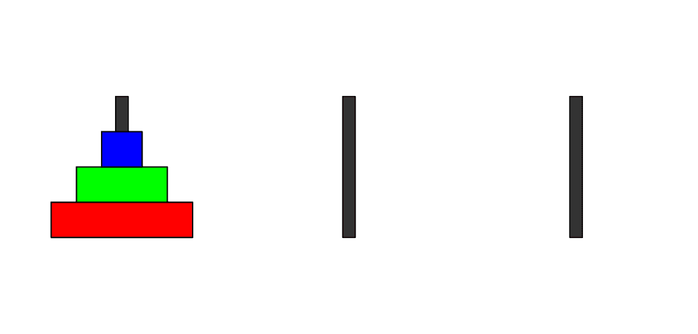

В этой лабораторной работе вы решите математическую головоломку, известную как «Ханойская башня». 

Головоломка состоит из трех стержней и нескольких дисков разного диаметра.

Последовательность ходов, необходимых для решения головоломки «Ханойская башня» с тремя дисками.
Головоломка начинается с того, что диски складываются на первом стержне в порядке уменьшения размера, при этом самый маленький диск находится сверху, а самый большой — снизу.

Цель головоломки «Ханойская башня» — переместить все фишки к последнему стержню. Для этого необходимо следовать трём простым правилам:

Перемещать можно только верхние диски.
За один раз можно перемещать только один диск.
Нельзя размещать диски большего размера поверх дисков меньшего размера.
Цель: Выполнить приведенные ниже пользовательские истории и добиться успешного прохождения всех тестов для завершения лабораторной работы.

Пользовательские истории:

Вам следует создать функцию, hanoi_solverкоторая принимает в качестве аргумента целое число, представляющее общее количество дисков головоломки.
Функция hanoi_solverдолжна решить головоломку, следуя заданным правилам. 2н− 1
 перемещения, где n— общее количество дисков.
Функция hanoi_solverдолжна возвращать строку со всеми ходами, сделанными для решения головоломки, включая начальное расположение, при этом каждый ход должен быть на новой строке. Стержни должны быть представлены в виде списков целых чисел (самый маленький диск обозначается числом 1), при этом каждый стержень разделяется пробелом. Например, функция hanoi_solver(3)должна возвращать следующее:
[3, 2, 1] [] []
[3, 2] [] [1]
[3] [2] [1]
[3] [2, 1] []
[] [2, 1] [3]
[1] [2] [3]
[1] [] [3, 2]
[] [] [3, 2, 1]
Тесты:
Ожидание :1. У вас должна быть функция с именем hanoi_solver.
Ожидание :2. Ваша hanoi_solverфункция должна принимать один аргумент.
Ожидание :3. Ваша hanoi_solverфункция должна возвращать строку.
Ожидание :4. hanoi_solver(2)должен вернуться [2, 1] [] []\n[2] [1] []\n[] [1] [2]\n[] [] [2, 1].
Ожидание :5. hanoi_solver(3)должен вернуть [3, 2, 1] [] []\n[3, 2] [] [1]\n[3] [2] [1]\n[3] [2, 1] []\n[] [2, 1] [3]\n[1] [2] [3]\n[1] [] [3, 2]\n[] [] [3, 2, 1].
Ожидание :6. hanoi_solver(4)должен вернуться [4, 3, 2, 1] [] []\n[4, 3, 2] [1] []\n[4, 3] [1] [2]\n[4, 3] [] [2, 1]\n[4] [3] [2, 1]\n[4, 1] [3] [2]\n[4, 1] [3, 2] []\n[4] [3, 2, 1] []\n[] [3, 2, 1] [4]\n[] [3, 2] [4, 1]\n[2] [3] [4, 1]\n[2, 1] [3] [4]\n[2, 1] [] [4, 3]\n[2] [1] [4, 3]\n[] [1] [4, 3, 2]\n[] [] [4, 3, 2, 1].
Ожидание :7. hanoi_solver(5)должен вернуться [5, 4, 3, 2, 1] [] []\n[5, 4, 3, 2] [] [1]\n[5, 4, 3] [2] [1]\n[5, 4, 3] [2, 1] []\n[5, 4] [2, 1] [3]\n[5, 4, 1] [2] [3]\n[5, 4, 1] [] [3, 2]\n[5, 4] [] [3, 2, 1]\n[5] [4] [3, 2, 1]\n[5] [4, 1] [3, 2]\n[5, 2] [4, 1] [3]\n[5, 2, 1] [4] [3]\n[5, 2, 1] [4, 3] []\n[5, 2] [4, 3] [1]\n[5] [4, 3, 2] [1]\n[5] [4, 3, 2, 1] []\n[] [4, 3, 2, 1] [5]\n[1] [4, 3, 2] [5]\n[1] [4, 3] [5, 2]\n[] [4, 3] [5, 2, 1]\n[3] [4] [5, 2, 1]\n[3] [4, 1] [5, 2]\n[3, 2] [4, 1] [5]\n[3, 2, 1] [4] [5]\n[3, 2, 1] [] [5, 4]\n[3, 2] [] [5, 4, 1]\n[3] [2] [5, 4, 1]\n[3] [2, 1] [5, 4]\n[] [2, 1] [5, 4, 3]\n[1] [2] [5, 4, 3]\n[1] [] [5, 4, 3, 2]\n[] [] [5, 4, 3, 2, 1].
Ожидание :8. hanoi_solver(n)следует решить головоломку «Ханойская башня» для любого положительного значения n.